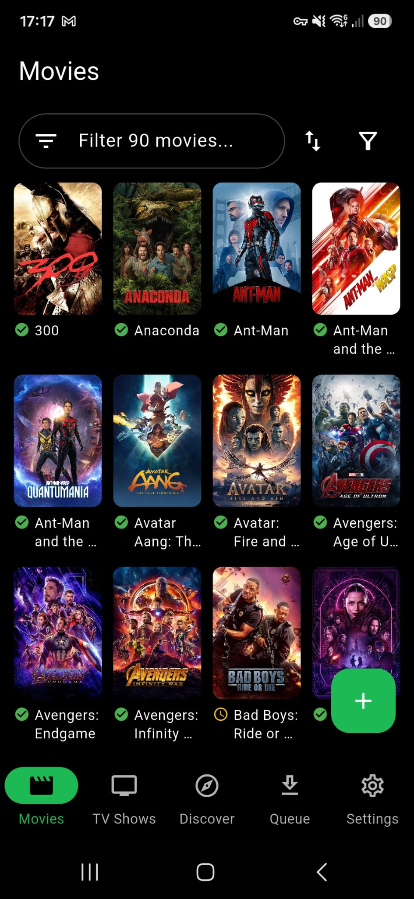
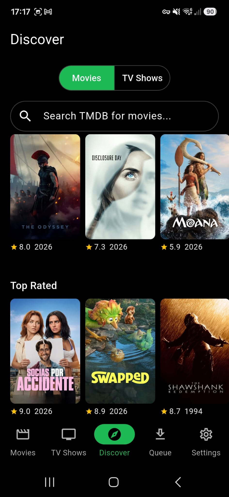
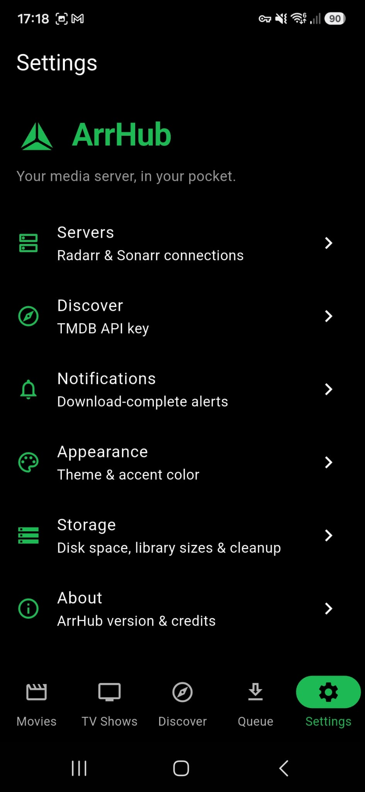

# ArrHub Mobile

**Your media server, in your pocket.** An Android app for managing your
[Radarr](https://radarr.video) and [Sonarr](https://sonarr.tv) servers from your
phone: browse your library, discover new movies and shows via TMDB, add them with
a chosen quality profile and root folder, and watch downloads progress live.

It's the companion to [ArrHub Desktop](https://github.com/ArrHub-Apps/ArrHubDesktop) —
scan the QR code the desktop app shows and both servers are configured
automatically — but it works standalone against any Radarr/Sonarr instance too.

<p align="center">
  
  &nbsp;
  
  &nbsp;
  
</p>

## Features

- **Movies & TV Shows** — your Radarr and Sonarr libraries with posters, download
  status, filtering and sorting.
- **Discover** — TMDB-powered trending / popular / top-rated carousels and search
  for both movies and TV, with one-tap add straight to Radarr/Sonarr and a
  person/filmography view.
- **Add new** — pick quality profile and root folder, with an optional immediate
  download search; series honour exact-season monitoring.
- **Queue** — a combined Radarr + Sonarr download queue with live progress and
  remove / blocklist actions.
- **QR pairing** — scan the code from ArrHub Desktop (**Settings → Sharing**) and
  both servers are configured for you, including the remote HTTPS address (with
  pinned certificate) and the host's TMDB key — no typing URLs or keys.
- **Notifications** — optional download-complete alerts.
- **Self-updating** — sideloaded, so it checks this repo's Releases and installs
  updates itself (you always confirm in the system installer).
- **Secure by default** — API keys live in Android's encrypted storage; remote
  connections are certificate-pinned.

### Screenshots

| Movies | Discover | Settings |
| --- | --- | --- |
|  |  |  |

## Install

Grab the latest **`app-release.apk`** from the [Releases](../../releases) page and
open it on your phone. Android will ask you to allow installs from this source the
first time — approve it, then tap **Install**.

Once installed the app keeps itself up to date: on launch and from
**Settings → App updates** it checks this repo's Releases and, if a newer build is
available, downloads the APK and hands it to Android's package installer. Nothing
installs silently — you opt in and confirm in the system UI.

> The update check reads Releases anonymously, so it only works while this repo is
> **public**.

No release published yet? Build it yourself — see below.

## Setup

You can connect to your servers two ways:

**Pair with ArrHub Desktop (easiest).** In the desktop app open
**Settings → Sharing** to show a pairing QR, then in the mobile app scan it. Both
Radarr and Sonarr are configured automatically, including remote access if the
host has it set up.

**Manual.** In Radarr/Sonarr, copy the API key from **Settings → General → API
Key**. In the app's **Settings → Servers**, enter each server's URL (e.g.
`http://192.168.1.10:7878` for Radarr, `:8989` for Sonarr) and API key, then
**Test** and **Save**. For Discover, add a TMDB API key under **Settings →
Discover**.

The app talks directly to your servers, so your phone must be able to reach
them — on the same LAN, or via a VPN such as WireGuard/Tailscale when away from
home (pairing with the desktop app sets this up for you).

## Build from source

### Prerequisites

- **Flutter** with Dart SDK **3.12+** (`flutter doctor` should be clean for
  Android).
- Android SDK / an emulator or a device with USB debugging.

### Run in development

```sh
flutter pub get
flutter run          # with a device or emulator connected
```

### Build an APK

```sh
flutter build apk    # -> build/app/outputs/flutter-apk/app-release.apk
```

> **Local signing.** A release build needs a signing config at
> `android/key.properties` (gitignored) pointing at your keystore — see
> [Cutting a release](#cutting-a-release) for why signing must be stable. Without
> it, use `flutter build apk --debug` for a quick local build.

> **AVG Antivirus (specific machines).** AVG intercepts HTTPS with its own root
> certificate, which Java doesn't trust by default. Build with a trust store that
> includes AVG's root:
> ```powershell
> $env:JAVA_TOOL_OPTIONS = "-Djavax.net.ssl.trustStore=C:\Users\dpbre\dev\cacerts-with-avg -Djavax.net.ssl.trustStorePassword=changeit"
> ```

## Releases & in-app updates

The app is sideloaded (not on the Play Store), so it updates itself. On launch and
from **Settings → App updates**, `lib/services/update_service.dart` checks the latest
release of this repo (`ArrHub-Apps/ArrHubMobile`), and if it's newer than the running
build, downloads the APK and hands it to Android's package installer (needs the
`REQUEST_INSTALL_PACKAGES` permission). Nothing installs silently — the user opts in
and confirms in the system UI.

> ⚠️ The update check reads the repo's Releases anonymously, so it only works once
> this repo is **public**. (Previously releases went to a separate public
> `MobileReleases` repo while this one was private; that's no longer needed.)

### Cutting a release

Releases are built and published by `.github/workflows/release.yml` on a version tag:

1. Bump `version` in `pubspec.yaml`, commit.
2. Tag and push: `git tag v0.2.0 && git push origin v0.2.0`.
3. CI builds a **signed** release APK and publishes it to this repo's Releases.

**Signing is mandatory and must be stable.** Android refuses an update whose signature
doesn't match the installed app, so every release is signed with the *same* keystore.
Locally that's `android/key.properties` (gitignored) + your keystore; in CI it's
reconstructed from repo secrets:

| Secret | What |
| --- | --- |
| `ANDROID_KEYSTORE_BASE64` | the `.jks` keystore, base64-encoded |
| `ANDROID_KEYSTORE_PASSWORD` | store password |
| `ANDROID_KEY_PASSWORD` | key password |
| `ANDROID_KEY_ALIAS` | key alias |

CI publishes to this repo's own Releases, so the built-in `GITHUB_TOKEN` (granted
`contents: write` in the workflow) is used — no PAT is needed.

Generate the keystore once (`keytool -genkey -v -keystore upload-keystore.jks -keyalg
RSA -keysize 2048 -validity 10000 -alias upload`), keep it safe, and base64 it into
`ANDROID_KEYSTORE_BASE64`. Losing it means users can't auto-update past that point.

## Project layout

```
lib/
  api/         Radarr/Sonarr v3 and TMDB API clients
  models/      ServerConfig, unified MediaItem, QueueItem
  state/       app_state.dart — per-service config + library/queue cache
  screens/     library, discover, queue, add-search, episodes, settings, QR pairing
  services/    self-update, notifications, desktop pairing, cert pinning, secure storage
  widgets/     posters, TMDB detail sheet, shared UI
android/       Android host project & signing config
.github/workflows/release.yml   Signed APK build + publish on a version tag
```

## Tech stack

Flutter · Dart 3 · Provider · `http` · `flutter_secure_storage` ·
`cached_network_image` · `mobile_scanner` · `flutter_local_notifications`

## License

[MIT](LICENSE).
